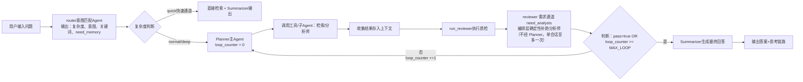

---
AIGC:
    Label: "1"
    ContentProducer: 001191440300708461136T1XGW3
    ProduceID: 619a68374c198f2d1dccd9a31deded68_4fba9f9fc90211f196f9525400248c00
    ReservedCode1: MBhbdX6Pwfy1INwkSO03ZlIHJ9PdO7KvwY5JAPhnEyxYo0YOHcvtXde3t3sNmdfS8JYP64fQosiTJPlIvL48xRKQ43a46bD1yAbiwU1IFjG99Z/TtpaDWQa4YCIo+EguFhejXU0+k7/u6Cq+UOO3lXAInwywRibFZs4cG3a3zJ8RP5Tghl0Xl0R+9eE=
    ContentPropagator: 001191440300708461136T1XGW3
    PropagateID: 619a68374c198f2d1dccd9a31deded68_4fba9f9fc90211f196f9525400248c00
    ReservedCode2: MBhbdX6Pwfy1INwkSO03ZlIHJ9PdO7KvwY5JAPhnEyxYo0YOHcvtXde3t3sNmdfS8JYP64fQosiTJPlIvL48xRKQ43a46bD1yAbiwU1IFjG99Z/TtpaDWQa4YCIo+EguFhejXU0+k7/u6Cq+UOO3lXAInwywRibFZs4cG3a3zJ8RP5Tghl0Xl0R+9eE=
---

# 多 Agent 编排方案 v4：标准主‑子Agent架构

> 版本：v4.0 正式版
> 配套：《AI方案文档.md》《总体设计文档.md》《详细设计文档.md》
> 定位：从「代码调度+LLM顾问」v3混合架构，升级为 **Planner主Agent全权调度 + 子Agent专项执行 + Reviewer闭环质检**；保留v3固定流水线作为降级兜底；适配Coze低代码平台。

## 1. 升级背景与目标

### 1.1 v3原有局限

- supervisor只是顾问角色，真正调度逻辑硬编码在Python外层代码；
- 无法动态拆解任意复杂用户问题；
- 缺少独立复审质检闭环；
- 没有证据不足自动迭代返工能力。

### 1.2 v4目标

1. **Planner主Agent作为总指挥**：动态拆解任务，通过工具调用自主调度检索、分析师、复审；
2. **新增Reviewer复审Agent**：独立质检，输出结构化报告，形成「调度‑执行‑质检‑返工」闭环；
3. 子Agent分工固化：`analyst‑method` / `analyst‑critic` / `analyst‑compare` / `Summarizer`；
4. 降级保护：Planner异常、工具调用解析失败，自动回退v3旧流水线；
5. Coze适配：没有原生Function‑call，使用标记+代码节点解析模拟工具调用。

## 2 角色与职责

### 2.1 层级划分

| 层级 | 角色 | 定位 | 模型要求 |
|---|---|---|---|
| 主Agent层 | Planner 规划主Agent | 总指挥，拆解任务、调度工具、控制迭代 | 支持Function‑call主力模型 |
| 子Agent层 | router 意图匹配Agent | 前置，输出复杂度、意图、关键词、是否需要记忆 | 轻量‑中量模型 |
|  | analyst‑method | 方法梳理，提取论文技术方案 | 主力模型 |
|  | analyst‑critic | 批判分析，挖掘局限、假设约束 | 主力模型 |
|  | analyst‑compare | 横向多方案对比 | 主力模型 |
|  | Reviewer | 复审质检，不生成内容，只做校验 | 主力模型 |
|  | Summarizer | 汇总生成面向用户最终回答 | 主力模型 |
| 工具层 | library_search / web_search / memory_search / rewrite_query / run_analysts / run_reviewer | 可调用工具，底层代码实现 | 纯代码节点 |

### 2.2 核心角色说明

**Planner主Agent**

1. 理解用户原始问题，拆分为可执行子任务；
2. 通过工具调用，选择执行检索、分析师、复审；
3. 接收工具/子Agent返回结果，判断证据是否充足；
4. 控制迭代轮次，到达上限强制结束，输出信息不完整标记。

**Reviewer复审Agent**

> 不写答案，只做质检，输入：user_query、context_evidence文献证据、analyst_outputs分析师输出

检查清单：

1. 幻觉校验：所有paper_id必须真实存在于传入证据；
2. 证据充足度：现有文献是否可以回答用户问题；
3. 逻辑一致性：多个分析师观点是否互相冲突；
4. 视角完整性：综述类是否遗漏主流流派、正反视角；
5. 置信标记：不确定结论是否标注【存疑，建议人工核验】。

输出固定JSON：

```json
{"pass":true,"defect_list":[],"suggestion":"给Planner的改进指令"}
```

## 3 工具清单

| 工具名 | 功能 | 入参 | 输出 |
|---|---|---|---|
| library_search | 本地 MySQL 文献检索，带 user_id 权限隔离 | user_id, keywords, start_date, end_date, source_list | 文献数组 paper_id/title/abstract 等 |
| web_search | 网络学术检索 | keywords, 时间范围 | 网络片段 + 来源链接 |
| memory_search | 读取会话历史 | session_id | 历史对话上下文 |
| rewrite_query | 查询改写，自然语言转检索条件 | user_query | 关键词、时间、来源过滤 |
| run_analysts | 批量调用分析师集群 | enable_list, context_evidence | method/critic/compare 文本输出 |
| run_reviewer | 调用复审 Agent | user_query, context_evidence, analyst_outputs | review_result JSON 报告 |

## 4 编排流程

### 4.1 流程图



### 4.2 循环约束

- MAX_LOOP = 3，最大迭代 3 轮，防止无限循环；
- 达到上限强制终止，输出提示：【分析已达到轮次上限，结果可能不完整，建议核对】。

### 4.3 复杂度三档

| 档位 | 判定 | 执行路径 |
|---|---|---|
| quick | 短句事实查询，单意图，约束少 | 快速通道，跳过 Planner、Reviewer |
| normal | 解释、简单对比，1‑2 个约束 | Planner 单轮调度，按需分析师，一次质检 |
| deep | 综述、多视角批判、多约束、跨会话 | 全量调度，三分析师 + 可多轮迭代 + 强制复审 |

## 5 降级容错策略

| 故障场景 | 处理方式 |
|---|---|
| Planner 输出解析失败、不支持 Function‑call | 自动回退 v3 旧流水线 route‑retrieve‑analyze‑summarize |
| Reviewer 执行异常 | 跳过质检，Summarizer 输出标注：【本次回答未经完整质检，仅供参考】 |
| 某个分析师调用失败 | 该视角输出置空，其余正常执行 |
| 所有检索工具无结果 | 返回证据不足提示，结束任务 |
| 迭代达到 MAX_LOOP 上限 | 基于现有证据输出，标注信息不完整 |

## 6 Coze 平台适配

Coze 没有原生 Function‑call，采用标记 + 代码节点模拟：

1. Planner 输出约定标记格式：`[[CALL:library_search]] {"keywords":["xxx"]}`
2. 后置代码节点正则解析文本，提取工具名称与参数；
3. 分发到对应子节点执行，执行完把结果回填上下文，重新回到 Planner；

### 6.1 Coze 全局工作流变量

| 变量名 | 类型 | 初始值 | 说明 |
|---|---|---|---|
| user_query | string | - | 用户原始提问 |
| loop_counter | number | 0 | 迭代计数 |
| MAX_LOOP | number | 3 | 最大迭代轮次 |
| context_evidence | array | [] | 保存全部检索到的文献证据 |
| analyst_outputs | object | {} | 保存 method/critic/compare 输出文本 |
| review_result | object | {} | Reviewer 输出 JSON 报告 |

## 7 成本控制

1. quick 简单问题分流，不走主 Agent 循环，减少 token 消耗；
2. normal/deep 按需调用分析师，不强制全部三个都跑；
3. 硬上限：迭代轮次、单会话工具调用次数；
4. 分层模型：路由用轻量模型，规划、分析、复审使用主力模型。
*（内容由AI生成，仅供参考）*
