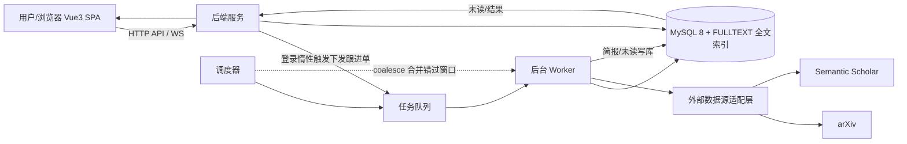

---
AIGC:
    Label: "1"
    ContentProducer: 001191440300708461136T1XGW3
    ProduceID: 619a68374c198f2d1dccd9a31deded68_edc6b521a8d411f188bd525400287e28
    ReservedCode1: olr6iNfZqfWYTCwtJHd8ZgX5jXTmYCz/y5rr4Lt1oUSVarP4XcS7MUkUOSDoLaWtR4SQGjAXFqomJHODOPy7yWzNTRpcMjO/eJBnE9ld2Jekc+vjxpHCq1RpAjog4ZiLpAXsmawh5eZrLeBGMViQFHVFx9AoLVvxoQabYaPONme4U5+R8M99Rg0nUQ4=
    ContentPropagator: 001191440300708461136T1XGW3
    PropagateID: 619a68374c198f2d1dccd9a31deded68_edc6b521a8d411f188bd525400287e28
    ReservedCode2: olr6iNfZqfWYTCwtJHd8ZgX5jXTmYCz/y5rr4Lt1oUSVarP4XcS7MUkUOSDoLaWtR4SQGjAXFqomJHODOPy7yWzNTRpcMjO/eJBnE9ld2Jekc+vjxpHCq1RpAjog4ZiLpAXsmawh5eZrLeBGMViQFHVFx9AoLVvxoQabYaPONme4U5+R8M99Rg0nUQ4=
---

# 总体设计文档：文献雷达 · 科研文献持续跟踪助手

> 概要 / 系统设计（High-Level Design）
> 版本：v2.1　|　配套：《PRD.md》《详细设计文档.md》《AI方案文档.md》《多agent编排方案v4.md》《前端设计文档v2.md》

---

## 1. 引言

### 1.1 目的

定义「文献雷达」系统的整体架构、模块划分、核心数据流、技术选型、部署形态与非功能设计，作为《详细设计文档》《AI方案文档》及编码实现的总纲。

### 1.2 范围

覆盖：前端 SPA、后端 API 服务、后台 worker、外部数据源适配、调度器，以及它们之间的交互与数据流。

### 1.3 设计原则

1. **管道型脏活用确定性代码，决策/综合分析用多 agent**：爬取、入库、去重等流程用确定性代码；仅在检索问答路由、多视角综述等"需综合判断"的场景引入 LLM 多 agent 协作。
2. **不依赖常驻在线**：以游标增量 + 调度合并 + 登录惰性触发 + 迟到合并简报保证非 7×24 可用场景不丢窗口。
3. **登录不阻塞**：登录快路径只读已入库数据；重活（拉 API / 去重入库）下发到独立后台 worker 异步执行。
4. **一栈式存储**：MySQL 8（InnoDB, utf8mb4）单库承载业务表，降低部署复杂度。
5. **LLM 分层降本**：跟进管道批量摘要用轻量模型，问答/综述用主力强模型。

---

## 2. 系统架构

### 2.1 架构总览（分层）

```
┌────────────────────────────────────────────────────────────────────┐
│                        用户 / 浏览器                                │
│                         Vue 3 SPA（5 视图）                        │
│   工作台 · 研究方向管理 · 文献问答 · 跟进日志 · 设置                 │
└──────────────────────────────┬─────────────────────────────────────┘
                               │ HTTP(S) API / WebSocket(可选)
┌──────────────────────────────▼─────────────────────────────────────┐
│                     后端服务（API 层）                              │
│   Auth │ Subscription CRUD │ 未读查询 │ 问答会话 │ 日志查询 │        │
│   登录惰性触发：校验通过 → 下发"跟进单" → 立即返回已入库数据          │
└──────────────┬──────────────────────────────┬──────────────────────┘
               │ 下发任务                     │ 读写
┌──────────────▼──────────────────────┐   ┌──▼─────────────────────────┐
│     后台 Worker（独立进程/线程，可选） │   │      MySQL 8（InnoDB, utf8mb4）│
│ 跟进管道：定时调度 → 增量抓取 → 去重   │◄──┤  业务表 + FULLTEXT 全文索引    │
│ → 筛选 → 入库 → 简报 & 未读           │   │  subscriptions/papers/       │
│ 任务队列：跟进单 / 问答路由           │   │  subscription_papers/         │
└──────────────┬──────────────────────┘   │  task_logs/users           │
        │ 调外部 API（限速/退避）          └────────────────────────────┘
┌──────────────▼──────────────────────┐
│   外部数据源适配层                    │
│   arXiv · Semantic Scholar · 其他    │
│   （API 限速、指数退避、增量参数）     │
└─────────────────────────────────────┘
```

```
时序要点：
  前端 ──登录──▶ 后端(快路径：只读已入库 + 下发跟进单) ──▶ 返回(不阻塞)
                      │ 下发
                      ▼
                   Worker：调度(coalesce) → 增量抓取 → 去重(硬/标题归一化) → 筛选 → 入库 → 简报+未读
                      │ 完成写库
                      ▼
   前端 ◀──轮询/WebSocket── 后端 ── 未读/结果刷新 ──▶ 徽标 + 弹窗
```

### 2.2 架构图（mermaid 版）



---

## 3. 模块划分与职责

| 模块 | 职责 | 关键产出 |
|---|---|---|
| 前端 SPA | 5 视图展示与交互、Pinia 状态、未读徽标/弹窗、多步问答状态展示 | 页面/组件（详见《前端设计文档v2.md》） |
| 后端 API 服务 | 鉴权、订阅 CRUD、未读查询、问答会话、日志查询、设置读写 | RESTful 接口（详见《详细设计文档.md》§3） |
| 鉴权与惰性触发 | 校验登录，成功即下发跟进单；快路径返回已入库数据 | 登录接口 + 跟进单下发 |
| 调度器 | 周期触发各启用方向跟进；coalesce 合并错过窗口 | 调度任务 |
| 后台 Worker | 执行跟进管道（抓取/去重/筛选/入库/简报）、问答路由编排 | 任务执行 |
| 外部数据源适配层 | 统一封装来源 API，处理分页/限速/退避/增量参数 | 数据源适配器 |
| 存储层 | MySQL 8（InnoDB, utf8mb4）：业务表 + FULLTEXT 全文索引 + 连接池；mysqldump 备份 | 数据库 |
| AI 编排层 | 标准主‑子Agent：Planner主Agent调度 + 子Agent专项执行 + 工具层 + Reviewer闭环质检；多 agent 协作定位：仅决策/综合分析任务使用；异常/开关关闭自动回退 v3 固定流水线 | 决策与综合分析 |
| 检索增强组件 | rerank 抽象层（默认 BM25Okapi 本地重排，未来可无缝升级 embedding）+ 本地静态元数据映射表（期刊等级/CCF/中科院分区/arXiv 分类，ISSN→期刊名回退匹配，代码级注入、零 LLM） | 跨源统一结果重排 + 展示前元数据增强（详见《详细设计文档.md》§4.5/§4.6） |
| 可观测 | task_logs 写入、任务级日志、前端日志视图 | 链路跟踪 |
| 权限与角色（RBAC） | 双角色划分（user/admin）；管理端 `/api/admin/**` 按 `require_role("admin")` 拦截；管理端模块：用户管理、模型管理 | 用户管理 + 模型管理两组接口 |
| 模型管理（admin） | 管理员维护模型池（添加/编辑/启停/参数），并为各 agent 绑定所用模型；支持 planner / reviewer 角色配置 | 模型 CRUD/启停 + agent 绑定接口 |
| 工具层 | library_search / web_search / memory_search / rewrite_query / run_analysts / run_reviewer，统一权限校验 | 可调用能力单元 |

---

### 3.1 权限与角色 + 管理端模块（RBAC）

> 角色仅两种：`user`（普通用户，默认，可用全部现有业务模块，见上文模块表）与 `admin`（管理员，仅管理端模块，预留扩展位）。管理端接口统一挂在 `/api/admin/**` 前缀下，经 `require_role("admin")` 拦截（FastAPI 依赖 / 装饰器 / 中间件，进入 handler 之前校验），非 admin 返回 403；普通业务视图对 admin 同样开放。

**管理端模块清单（本期）**

| 模块 | 职责 | 数据 / 接口 |
|---|---|---|
| 用户管理 | 用户列表、启用/停用、角色调整（user⇄admin）、最后一名管理员保护 | `users` 表；`/api/admin/users/**` |
| 模型管理 | 管理员维护模型池：添加/编辑/启停模型配置（含 api_key 仅服务端、能力标签、是否默认），并按 agent 绑定使用模型（模型池 → 各 agent 映射） | `models`、`agent_model` 表；`/api/admin/models/**`、`/api/admin/agents/**` |

> 扩展位：后续新增管理能力沿用同一前缀与拦截，业务侧零鉴权改造。模型池与 agent 绑定为 AI 环节提供"可配置"的模型来源（见《AI方案文档.md》§1.1、§2）。

---

## 4. 核心数据流

### 4.1 跟进管道四段式

```
定时调度(coalesce 合并错过窗口)
        │
        ▼
① 定时调度  ──►  ② 增量抓取  ──►  ③ 去重筛选  ──►  ④ 主动汇报
  取启用订阅      基于 last_run_at   硬去重(external_id 唯一索引)
                 只拉增量            + 标题归一化/FULLTEXT 近似去重
                 来源限速/退避        + 三层打分：
                                   元数据过滤 → 关键词/FULLTEXT 命中打分(BM25) → 可选 LLM 精筛
                                                            │
                                   ④ 简报 + 未读计数写库 ──► 前端徽标/弹窗
```

关键点：
- **增量**：`last_run_at` 游标只拉上次之后新增，避免全量重拉；
- **去重**：`external_id`/DOI 唯一索引硬去重 + 标题归一化比对（FULLTEXT 近似匹配兜底）；
- **汇报**：完成即写简报与未读，驱动前端被动/主动刷新。

### 4.2 登录惰性触发流

```
用户登录
  │
  ├─① 校验凭据（快路径）──────────────────────────────┐
  │                                                   │
  ├─② 下发跟进单（异步写队列）                        │
  │                                                   │
  └─③ 立即返回：已入库数据 + 未读统计（不阻塞登录）    │
                                                     ▼
                 Worker 消费跟进单：拉API/去重/入库（重活）
                          │
                          ▼
                 未读/简报更新 ──▶ 前端轮询或 WS 刷新徽标
```

### 4.3 问答多 agent 路由流（标准主‑子Agent v4）

```
用户提问(QaView，支持 phrase / paragraph / strategy 三模式)
   │
   ▼
查询改写（LLM 自由问句→结构化检索式：关键词+年份/来源/分类；失败回退原问句）
   │
   ▼
router 路由（规则 + LLM 兜底）→ 判定 quick / normal / deep
   │
   ├─ quick：快速通道 → 检索 → 汇总输出
   │
   └─ normal/deep：Planner 主 Agent 闭环（enable_planner=true 时）
      │
      ├─ 动态拆解任务 → 调工具 / 子 Agent
      ├─ 收集结果
      ├─ Reviewer 质检
      │   ├─ 不通过且未超限(MAX_LOOP=3) → 返工循环
      │   └─ 通过 / 超限 → 汇总输出
      │
      └─ 生成带引用的最终回答

降级：异常/enable_planner=false → 自动回退 v3 固定流水线
```

---

## 5. 技术选型及理由

| 领域 | 选型 | 理由 |
|---|---|---|
| 前端框架 | Vue 3 + Vite + TypeScript | 组合式 API 高效、类型安全、构建快；与既有 Vue 工程一致 |
| 前端 UI 技术 | Tailwind CSS 4 + Pinia + Vue Router + lucide | 令牌化样式、集中状态、路由驱动视图（详见《前端设计文档v2.md》） |
| 后端语言 | Python 3.11+ | AI 生态成熟（LLM SDK、全文检索、异步）；既有工程基线 |
| Web 框架 | FastAPI | 异步原生、OpenAPI 自动文档、类型校验友好 |
| 存储 | MySQL 8（InnoDB, utf8mb4） | 大学生个人/课程项目规模，单库承载业务表，MySQL 已足够；RAG 阶段不做故无需 pgvector |
| 去重/检索索引 | FULLTEXT（ngram）+ 普通索引 | 全文近似匹配（支持中文）+ 元数据过滤，满足检索与去重兜底 |
| 数据库驱动 | mysql-connector-python / SQLAlchemy 类 + 连接池 | 连接复用，降低开销（选型时以最终实现为准） |
| 任务队列 | 内存队列 / RQ / Celery 可选（进程分离） | 登录惰性触发与调度异步执行；本机单进程可先内存队列，多进程再升级 |
| 主Agent模型 | 支持 Function‑call 的主力大模型 | 支持工具调用与多步规划，Planner 必须启用此能力 |
| LLM 调用 | 标准主‑子Agent v4（Planner + 子Agent + 工具层 + Reviewer）；异常/开关关闭自动回退 v3 固定流水线；MAX_LOOP=3 | Planner 全权调度，子Agent专项执行，闭环质检 |
| 结果重排 | rank_bm25（BM25Okapi）rerank 抽象层 | 检索后对结果集做跨源统一重排，替代原 TF-IDF 思路；与 MySQL FULLTEXT（类 BM25）检索层分层定位；接口抽象，未来可无缝升级 embedding 重排 |
| 本地元数据 | 静态映射表（期刊等级/CCF/中科院分区/arXiv 分类）代码级注入 | ISSN→期刊名回退匹配，展示前增强；零 LLM 成本 |
| 外部数据源 | arXiv API、Semantic Scholar API 适配器；万方 Wanfang 无公开 API，走 JS 渲染抓取适配器（UA/Referer/无头浏览器/限速）；Google Scholar 受限候选（网络直连被阻断，需代理/镜像或机构授权后接入） | 官方接口合规限速；无 API 源走渲染抓取，两源实测状态与接入细节见《详细设计文档.md》§3.7 |
| 前端未读刷新 | 轮询（默认） + WebSocket 可选 | 轻量、不需常驻长连接，符合非在线容错取向 |

---

## 6. 部署形态

### 6.1 部署形态表

| 形态 | 说明 | 适用 |
|---|---|---|
| 本机单进程（默认） | MySQL 8（本机或容器）+ 后端进程内嵌调度器与 worker（线程/协程）；前端 `vite build` 产物由后端托管或独立静态服务 | 单人/小团队起步 |
| Docker 组合 | `docker-compose`：`db`(mysql:8, InnoDB, utf8mb4) + `api` + `worker`(可选分离) + `web`(构建产物) | 需要可移植、多进程分离 |
| 进程分离（可选） | API 进程与 Worker 进程分离，任务队列独立（如 Redis + RQ/Celery） | 文献量大、需独立扩缩容 |

### 6.2 部署决策点

- 默认可**单进程 + 内存队列**运行完整功能（调度器、worker 后台线程），满足"非在线容错"与轻量部署；
- 需要水平扩容或隔离故障时，再切换为**独立 worker 进程 + 外部队列**，业务代码无需大改（队列接口抽象）。

---

## 7. 非功能设计

| 维度 | 设计 |
|---|---|
| 容错（非在线） | ① 游标增量 ② 调度 coalesce 合并错过窗口 ③ 登录惰性触发补跑 ④ 迟到合并简报（详见《详细设计文档.md》§4.7） |
| 限速与退避 | 外部数据源适配层统一限速；请求失败/429 走指数退避（`2^n` 秒 + 抖动），不打死上游 |
| 备份 | `mysqldump`（含库内全文数据）定期备份，提供恢复步骤；关键配置以环境变量管理 |
| 可观测 | `task_logs` 每任务一行；任务 id 贯穿 worker 日志；前端日志视图 + 后端日志双层；Planner/Reviewer 决策记录随 result 返回 |
| 安全 | 凭据仅服务端环境变量；登录惰性触发不泄露未读细节给未授权；数据按 user_id 隔离（预留）；管理端 `/api/admin/**` 按 admin 角色拦截（RBAC，见 §3.1） |
| 性能 | 连接池、FULLTEXT/普通索引、接口只读快路径；问答多步异步呈现避免同步长阻塞 |
| RAG 暂缓 | 当前阶段不做 RAG/向量检索；结果重排统一走 rerank 抽象层（BM25Okapi 本地默认，接口不变可升级 embedding）；若后续引入向量检索需保证 embedding 选型稳定、全量重嵌入规划 |

---

## 8. 附录：与前端设计文档 v2 的对应

| 前端视图 | 后端/存储耦合点 |
|---|---|
| 工作台（未读徽标/弹窗/运行跟进） | 未读查询接口、运行跟进触发接口 |
| 研究方向管理 | 订阅 CRUD、批量删除、启停 |
| 文献问答 | 问答会话接口（异步多步） |
| 跟进日志 | 日志查询接口 |
| 设置 | 设置读写接口 |

前端各组件 Props/Emits、Pinia store 结构、路由表见《前端设计文档v2.md》；视觉/交互规范见《前端设计文档v2.md》。
*（内容由AI生成，仅供参考）*
